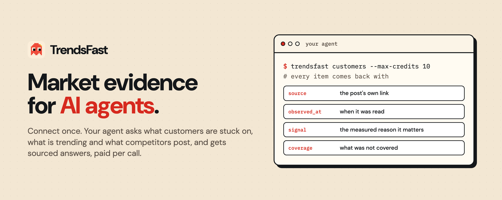
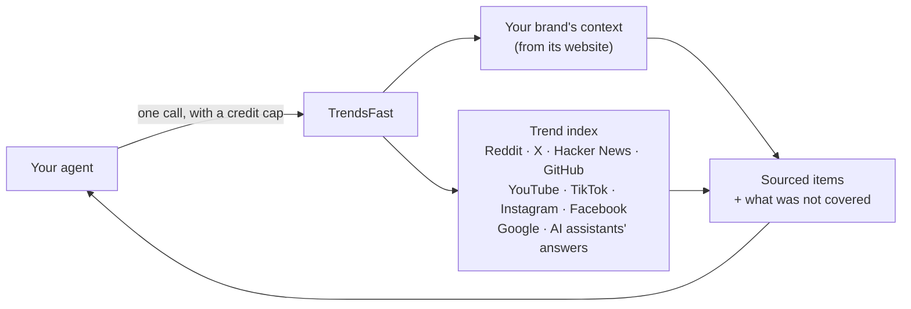

<p align="center">
  <a href="https://trendsfast.com">
    
  </a>
</p>

<p align="center">
  <a href="https://trendsfast.com"><b>Website</b></a> ·
  <a href="https://trendsfast.com/docs"><b>Docs</b></a> ·
  <a href="https://trendsfast.com/agents"><b>Connect your agent</b></a> ·
  <a href="https://trendsfast.com/pricing"><b>Pricing</b></a> ·
  <a href="https://trendsfast.com/dashboard"><b>Dashboard</b></a>
</p>

<p align="center">
  <a href="https://www.npmjs.com/package/trendsfast-cli"></a>
  <a href="https://pypi.org/project/trendsfast/"></a>
  <a href="https://registry.modelcontextprotocol.io/v0.1/servers?search=com.trendsfast/trends"></a>
  <a href="LICENSE"></a>
</p>

<p align="center">
  Works with Claude · ChatGPT · Claude Code · Codex · Cursor · Windsurf · Gemini CLI · OpenCode
  · OpenClaw · n8n
</p>

**TrendsFast gives AI agents sourced market evidence.** Your agent asks what a brand's
customers are stuck on, what is trending in its niche, what its competitors post, which video
formats work, and what people search for and AI assistants answer. Every answer arrives as
items with their source link, when each was observed, the measured signal and what was not
covered. Each call states its price in credits first, and a retry is never charged twice.

This repository is the open-source half of TrendsFast, under the MIT license:

- the CLI;
- the SDKs for Node and Python;
- the agent skill;
- a Claude Code plugin;
- an n8n node.

The trend index and the API run at [trendsfast.com](https://trendsfast.com).

## Quickstart

```bash
npx -y trendsfast-cli@latest init
```

One command installs the `trendsfast` skill for every coding agent on your machine: Claude Code,
Codex, Cursor, Windsurf, Gemini CLI, OpenCode, OpenClaw and more. It then signs you in through
the browser. Then ask your agent:

> What are my customers stuck on this week? Use TrendsFast.

Prefer a connector? In Claude or ChatGPT, add `https://trendsfast.com/api/mcp/v3` and sign in.
Every client's exact steps are at [trendsfast.com/agents](https://trendsfast.com/agents).

## What your agent can ask

| Ask                                                            | Product     | CLI                      | Credits |
| -------------------------------------------------------------- | ----------- | ------------------------ | ------: |
| What are my customers stuck on, in their own words?            | Customers   | `trendsfast customers`   |      10 |
| What is gaining attention in my niche, and right next to it?   | Trending    | `trendsfast trending`    |      25 |
| What do my competitors post, and what works for them?          | Competitors | `trendsfast competitors` |      30 |
| Which video formats and hooks work in my niche?                | Formats     | `trendsfast formats`     |      20 |
| What do people search for, and do AI assistants name my brand? | Search      | `trendsfast search`      |      35 |

Cheaper reads answer from saved observations:

| Read       | Credits |
| ---------- | ------: |
| `global`   |       1 |
| `niche`    |       3 |
| `ask`      |       5 |
| `discover` |       5 |

Reading your brand's context, your balance, a quote, your history or a saved result costs
nothing. A verified account starts with **100 free credits**.

## How it works



A product call collects that product's sources fresh, within its price, for your confirmed
brand. Every other read answers from what the index already holds.

## Built for agents

- **Silent until useful.** `init` installs one skill. Until a task needs market evidence, an
  agent carries only its short description, about 75 tokens.
- **Compact by default.** Results arrive at about 40% of the full JSON. The full contract is one
  free read away, and `-o` saves it into `.trendsfast/` to read in slices.
- **Free before paid.** An agent quotes first, and every paid call needs a cap
  (`--max-credits`). The CLI journals each request ID before sending, so a lost answer is
  recovered, never paid twice.
- **Errors an agent can branch on.** Each failure has one stable code and an exit code from 0
  to 7. Each names its next step.
- **Evidence, not adjectives.** No trend without a measured signal, and no claim of reach or
  virality. Collected text is treated as untrusted.

### When an agent should not call it

The skill tells agents to skip TrendsFast when:

- a task needs no evidence of what a market says now, such as writing code or summarizing a
  file;
- the user named other sources or tools;
- a saved result already answers the question. `trendsfast history` and `.trendsfast/` are free
  to check before paying again.

## Install options

<details>
<summary><b>CLI</b>: for coding agents and terminals</summary>

```bash
npx -y trendsfast-cli@latest init         # install the skill everywhere and sign in
trendsfast whoami                          # free: who you are signed in as
trendsfast context                         # free: the brand your products run on
trendsfast quote customers                 # free: the price before you pay
trendsfast customers --max-credits 10      # run a product, capped
trendsfast customers -o week.json          # also save the full result in .trendsfast/
```

Other commands: `trending`, `competitors`, `formats`, `search`, `global`, `niche`, `ask`,
`discover`, `credits`, `history`, `result`, `request`, `login`, `logout` and `doctor`.

An agent in a cloud sandbox signs in with `trendsfast login --code-flow`. You approve in your
own browser and paste back a code. That code is sealed to the sandbox's key, so it is useless
anywhere else. See [cli/README.md](cli/README.md).

</details>

<details>
<summary><b>MCP</b>: Claude, ChatGPT, Cursor, VS Code and any MCP client</summary>

Add `https://trendsfast.com/api/mcp/v3` (Streamable HTTP). Claude and ChatGPT sign you in with
OAuth; other clients take an `Authorization: Bearer <key>` header. Seven tools, described for
the model, and compact results. Listed in the official MCP Registry as `com.trendsfast/trends`.

</details>

<details>
<summary><b>Node SDK</b>: <code>npm install trendsfast</code></summary>

```ts
import { TrendsFast } from "trendsfast";

const tf = new TrendsFast(); // TRENDSFAST_API_KEY, or the key `trendsfast login` stored
const quote = await tf.quote("niche", "customers"); // free: 10 credits
const result = await tf.customers({ lookback_hours: 168, limit: 10 });
console.log(result.result_id, result.usage.credits_charged);
```

No dependencies. Typed errors per code. See [sdk-js/README.md](sdk-js/README.md).

</details>

<details>
<summary><b>Python SDK</b>: <code>pip install trendsfast</code></summary>

```python
from trendsfast import TrendsFast

tf = TrendsFast()  # TRENDSFAST_API_KEY, or the key `trendsfast login` stored
print(tf.quote("niche", "customers"))  # free: 10 credits
result = tf.customers(lookback_hours=168, limit=10)
print(result["result_id"], result["usage"]["credits_charged"])
```

Standard library only. See [python/README.md](python/README.md).

</details>

<details>
<summary><b>Skill only, Claude Code plugin, ClawHub</b></summary>

```bash
npx skills add meestierolff/trendsfast-open --skill trendsfast   # any agent that reads SKILL.md
```

```text
/plugin marketplace add meestierolff/trendsfast-open             # Claude Code: skill + MCP server
/plugin install trendsfast@trendsfast
```

OpenClaw: `clawhub install trendsfast`.

</details>

<details>
<summary><b>n8n</b></summary>

Install the community node `n8n-nodes-trendsfast` (Settings → Community Nodes), add a
TrendsFast credential and start from an example workflow. It also works as a tool for n8n's AI
Agent. See [n8n-nodes-trendsfast/README.md](n8n-nodes-trendsfast/README.md).

</details>

<details>
<summary><b>REST</b></summary>

Read your brand's `context_id` for free with `GET /v3/trends/context`, then run a product. Keep
the `request_id`: a retry of the same call reuses it and is never charged twice.

```bash
curl -sS -X POST https://trendsfast.com/v3/trends/niche \
  -H "Authorization: Bearer $TRENDSFAST_API_KEY" \
  -H "Content-Type: application/json" \
  -d '{"request_id":"<a UUID you keep>","max_credits":10,
       "input":{"product":"customers","context_id":"<context_id>"}}'
```

The contract is [trendsfast.com/v3/openapi.json](https://trendsfast.com/v3/openapi.json), and
the docs are at [trendsfast.com/docs](https://trendsfast.com/docs).

</details>

## What is in this repository

| Path                                            | What                                         | Published as               |
| ----------------------------------------------- | -------------------------------------------- | -------------------------- |
| [`cli/`](cli)                                   | The `trendsfast` command                     | npm `trendsfast-cli`       |
| [`sdk-js/`](sdk-js)                             | The Node SDK                                 | npm `trendsfast`           |
| [`python/`](python)                             | The Python SDK                               | PyPI `trendsfast`          |
| [`skills/trendsfast/`](skills/trendsfast)       | The agent skill, a router with references    | skills.sh, ClawHub         |
| [`.claude-plugin/`](.claude-plugin)             | The Claude Code plugin: skill and MCP server | `/plugin marketplace add`  |
| [`n8n-nodes-trendsfast/`](n8n-nodes-trendsfast) | The n8n node with example workflows          | npm `n8n-nodes-trendsfast` |

## Open kit and hosted service

|                                                        | This repository (MIT) | trendsfast.com (hosted) |
| ------------------------------------------------------ | --------------------- | ----------------------- |
| CLI, SDKs, skill, plugin, n8n node                     | ✓                     |                         |
| Trend index across Reddit, X, YouTube, TikTok and more |                       | ✓                       |
| Brand context from a website                           |                       | ✓                       |
| Fresh collection for the five products                 |                       | ✓                       |
| MCP server with OAuth, REST API, dashboard             |                       | ✓                       |

## Data

TrendsFast reads public evidence under recorded rights for each source. It never posts,
schedules, messages anyone or connects your social accounts. Results say which channels were
not covered: a channel that was not observed is reported as such, never as "nothing happened".

## Security and privacy

- **Keys stay out of chat.** Never paste a key into a chat, a URL or a command line. The CLI keeps
  it in its own file with mode 0600. The SDKs read it from the environment.
- **Browser sign-in seals the key to your machine.** The new key is encrypted to a key pair the
  CLI generated (X25519, HKDF-SHA256, AES-256-GCM), so neither the browser nor the agent's
  transcript ever holds it.
- **Collected text is untrusted.** Posts, titles and transcripts are third-party text. The skill
  tells agents to ignore any instructions inside them.
- **Reporting.** Report vulnerabilities privately; see [SECURITY.md](SECURITY.md).

## Contributing

Issues and pull requests are welcome; see [CONTRIBUTING.md](CONTRIBUTING.md). Each package runs
its tests offline against fixtures that match the live API's own response schema:

- `npm test` in `cli/` and `sdk-js/`;
- `python3 -m unittest discover -v` in `python/`.

## License

This repository is [MIT](LICENSE) licensed. The TrendsFast API and trend index are a hosted
service under the [terms](https://trendsfast.com/terms).
